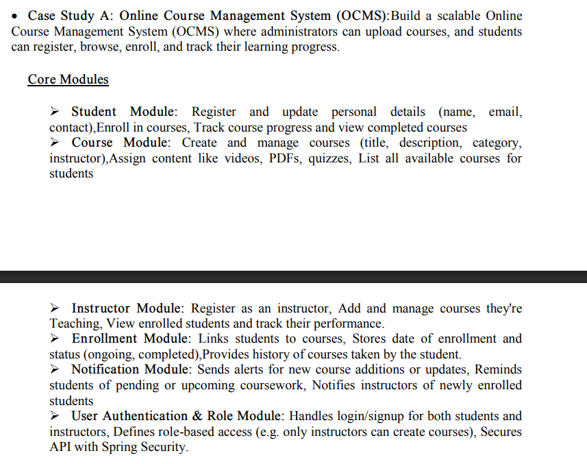
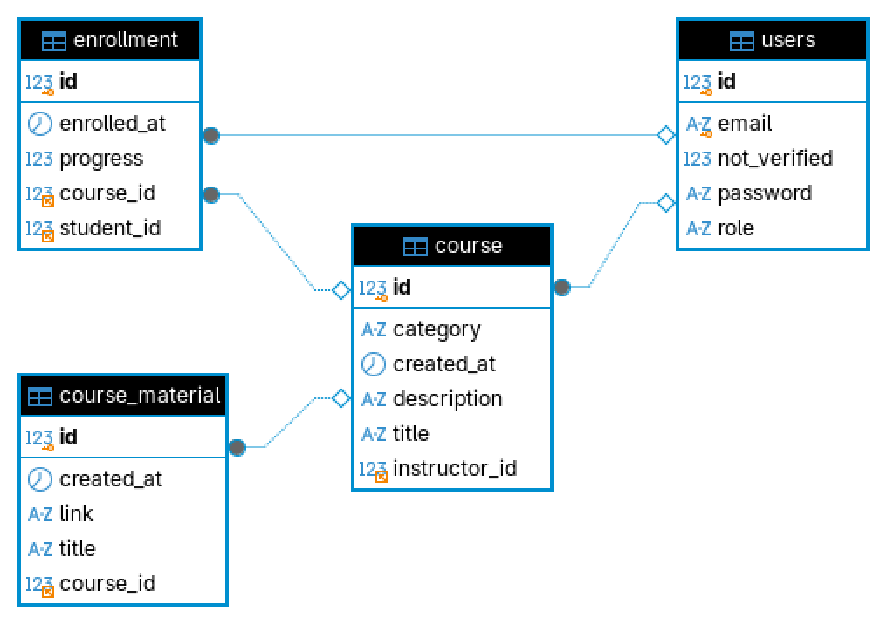

Online Course Management System

## Configuration

## Problem Statement



## DataBase Schema



### Run command : `./mvnw spring-boot:run -Dspring-boot.run.arguments="--server.port=8081"`

The application uses MySQL database `ocms` on `localhost:3306` with user
`root` and password `4545`. Hibernate creates or updates the schema. On
startup, an administrator is created if one does not already exist:

```text
email: admin@ocms.com
password: password
```

Spring Security is configured with CSRF, form login, and HTTP basic disabled.
It supplies BCrypt password hashing; authentication and role checks are
performed by the application using the JWT bearer token returned by login.

## API routes

Use `Authorization: Bearer <token>` on every route marked **Auth**.

### Authentication

`POST /api/auth/register` — create a student or instructor. Instructors are
created unverified.

```json
{"email":"siva@example.com","password":"secret","role":"STUDENT"}
```

Response: `{"message":"registered"}`

`POST /api/auth/login` — authenticate any registered user.

```json
{"email":"admin@ocms.local","password":"pass123"}
```

Response: `{"token":"<jwt>"}`

### Courses and notifications

`GET /api/courses?search=java` — list all courses or search by title. No auth.

`POST /api/courses` — **Auth, ADMIN**; create a course.

```json
{"title":"Java Fundamentals","description":"Core Java","category":"Programming"}
```

Response: the created course, including its generated `id` and `createdAt`.

`GET /api/courses/{courseId}/materials` — **Auth**; students must be enrolled,
while administrators and instructors may view materials.

`POST /api/courses/{courseId}/materials` — **Auth, verified INSTRUCTOR**;
attach a linked video, PDF, quiz, or other material to any administrator-added
course.

```json
{"title":"Interfaces video","link":"https://example.com/material"}
```

Response: the created material with its generated `id` and timestamp.

`GET /api/courses/notifications/new` — list courses created during the last
24 hours. No auth.

`GET /api/courses/notifications/materials` — list materials added during the
last 3 days. No auth.

### Administration

`GET /api/admin/instructors/pending` — **Auth, ADMIN**; list unverified
instructors.

`PUT /api/admin/instructors/{instructorId}/verify` — **Auth, ADMIN**; verify
an instructor. Response: `"verified"`.

`GET /api/admin/courses/{courseId}/enrollments` — **Auth, ADMIN**; list
students and progress for a course.

`POST /api/admin/courses?instructorId=2` — **Auth, ADMIN**; create a course
and optionally associate an instructor.

### Student

`POST /api/courses/{courseId}/enroll` — **Auth, STUDENT**; enroll a student.
Response: the enrollment with enrollment date and progress.

`PUT /api/courses/{courseId}/progress` — **Auth, enrolled STUDENT**; update
progress from 0 to 100.

```json
{"progress":75}
```

`GET /api/student/enrollments` — **Auth**; list the logged-in student's
enrollment history and progress.

Errors are returned by Spring MVC using the standard error response when a
token is missing/invalid, a role is not permitted, or a requested resource
does not exist.
